<h3><code>gabriel@github ~ $ ./contributions.sh</code></h3>

  

<h3><code>gabriel@github ~ $ whoami</code></h3>
<table>
  <tr>
    <td valign="top"></td>
    <td valign="top"></td>
  </tr>
</table>

 

<h3><code>gabriel@github ~ $ cat about.md</code></h3>

I build and maintain the backend and frontend of a **last-mile logistics platform** running in production:
REST APIs in **Node.js/Express**, **PostgreSQL** with Sequelize, background jobs on **Redis**,
and a large legacy **Angular / jQuery / Kendo UI** frontend under active modernization.

Most of my work sits where **money, identity and legacy code** meet:

- **Enterprise SSO**: OAuth2 / OIDC, integrating Okta, Auth0 and Microsoft (MSAL),
  including claims challenge and step-up MFA flows.
- **Application security**: removing `unsafe-inline` and `unsafe-eval` from the
  Content Security Policy of a legacy codebase, without breaking a decade of inline handlers.
- **Billing & business rules**: invoice calculation, SLA rules, penalties, disputes and
  refunds, shipped behind **feature flags** for controlled rollout.
- **Async processing**: scheduled jobs, queues and workers for batch financial routines.
- **Mobile features**: Flutter screens integrating a facial-biometrics SDK for identity validation.

Graduated in Systems Analysis & Development and in Computer Engineering.
Design background too (After Effects, Photoshop, Premiere, Figma), useful more often than you'd think when the product still needs to *look* finished.

<h3><code>gabriel@github ~ $ ls ~/stack</code></h3>

  

<!-- ## Selected projects -->

<!--  | Project | What it is | Stack |
|---|---|---|
| **[nome-do-repo](#)** | *uma linha: o problema que resolve* | Node.js · PostgreSQL |
| **[nome-do-repo](#)** | *uma linha: o problema que resolve* | NestJS · DDD |
-->

Heatmap regenerated daily by GitHub Actions from public contribution data. Monogram, terminal session, card and heatmap are hand-rolled animated SVGs (see <code>scripts/</code>).
